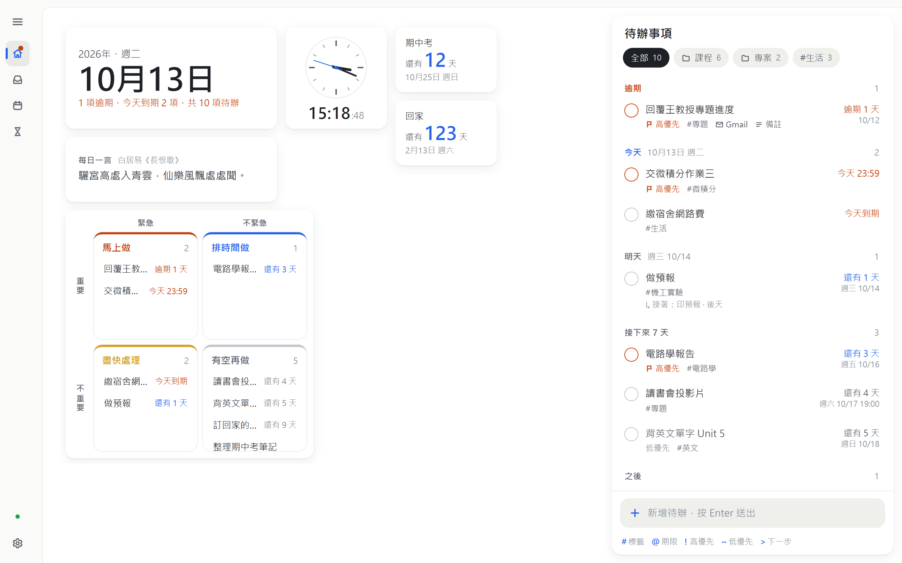
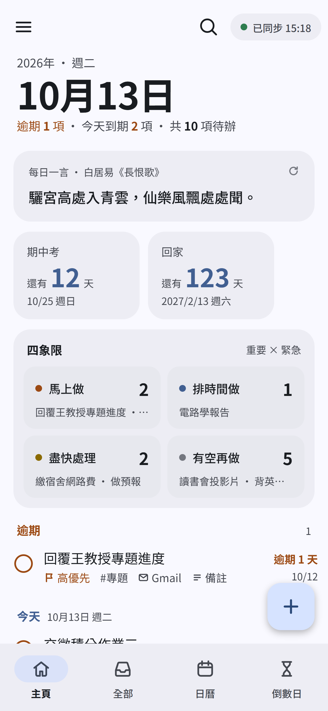

<!-- markdownlint-disable -->

# Deskdo

    
    
    

 

Deskdo 的意思是 Desk + To-do

一款貼在桌面上的待辦清單

手機、平板、AI 助理一起管，打開桌面就看得到！

認真更新中 (๑•̀ㅂ•́)و✧

<!-- markdownlint-restore -->

## 下載與安裝

到 [官網](https://deskdo.adaizaiganma.qzz.io/) 或 [Releases](https://github.com/adaizaiganma/deskdo/releases/latest) 下載。裝好之後會自動更新，不用再回來下載。

| 裝置 | 怎麼裝 |
|---|---|
| **Windows 10／11** | 下載 `Deskdo_…_x64-setup.exe`，打開就能安裝，不需要系統管理員權限 |
| **Android** | 在手機上下載 `Deskdo_…_arm64.apk` 安裝 |
| **iPhone、iPad** | 不用安裝。在電腦或 Android 的「設定 → 在 iPhone、iPad 使用」用相機掃 QR code，加到主畫面，輸入配對碼就好 |

第一次打開會有設定精靈帶你登入 Cloudflare（免費），大約 2 分鐘，不用打任何指令。

## 亮點功能

- 毛玻璃小工具貼在桌面上，待在所有視窗下面，按 Win+D 就看得到，不佔工作列
- Android 主畫面小工具，直接在桌面上打勾完成；iPhone、iPad 打開網頁就能用
- 打字就排好：輸入「交報告 #電路學 @週五 !」，標籤、期限、優先度一次搞定 ~~（再也沒有藉口忘記交作業了）~~
- 主頁一眼看完：今天要做的事、日曆、倒數日、重要／緊急四象限，背景換成自己喜歡的照片
- 多個步驟的事情可以接成一串，做完上一步，下一步才出現
- 電腦、手機、平板看到的都是同一份待辦，改了馬上同步
- 接上 Claude、ChatGPT 等 AI 助理，說一句「幫我加一個週五交報告」「這週還有什麼沒做？」就好（選用）
- 搭配 AI 助理的排程，每天早上自動把作業、繳費、要回覆的 Gmail 整理成待辦，不會重複新增（選用）
- 資料存在你自己的 Cloudflare 帳號，開發者看不到也碰不到，專案哪天不維護了資料也還在

話不多說，看圖！

<picture>
  <source media="(prefers-color-scheme: dark)" srcset="./docs/images/desktop-dark.png">
  
</picture>

<picture>
  <source media="(prefers-color-scheme: dark)" srcset="./docs/images/phone-dark.png">
  
</picture>

## 使用說明

### 功能介紹

請參閱 [使用說明](https://deskdo.adaizaiganma.qzz.io/guide)。

### 隱私

Deskdo 沒有自己的伺服器，App 和 AI 助理讀寫的都是你 Cloudflare 帳號裡的資料。登入 Cloudflare 的憑證只在設定精靈執行時使用，不會存到硬碟。請參閱 [隱私說明](https://deskdo.adaizaiganma.qzz.io/privacy)。

### 常見問題

手機可以用嗎？

可以。Android 有 App，主畫面還有小工具，可以直接打勾完成。iPhone、iPad 用網頁版：在電腦或 Android 的「設定 → 在 iPhone、iPad 使用」產生配對碼，用相機掃 QR code 打開，加到主畫面後輸入配對碼，之後就像 App 一樣從主畫面打開。

為什麼 iPhone 沒有 App？

Deskdo 目前沒有上架 App Store，iPhone、iPad 請用網頁版。網頁版由你自己的雲端提供，資料一樣只在你的帳號裡；配對一次之後就不用再輸入配對碼。

有 Mac 版嗎？

目前沒有。Mac 上可以用瀏覽器開網頁版（一樣用配對碼），介面和電腦版的主視窗一樣，只是沒有桌面小工具。

要付錢嗎？

不用。Deskdo 免費；Cloudflare 的免費方案每天能處理 10 萬次請求，一台開著 Deskdo 的電腦一天大約只用 3 千次。

不用 AI 也能用嗎？

可以。AI 是額外的功能，設定精靈最後一步直接跳過就好，之後想接再到設定裡找網址。

會自動更新嗎？

會。電腦版在背景下載新版，按「重新啟動並更新」就好；Android 會在主畫面提示，按一下下載安裝，資料都會保留；網頁版跟著你的雲端更新。有些新版需要更新雲端，畫面上會出現「雲端有新版本」，按一下並登入 Cloudflare 即可，資料不會變動。

安裝時 Windows 說「Windows 已保護您的電腦」？

因為 Deskdo 還沒有買程式碼簽章憑證，新的程式都會出現這個提示。點「其他資訊」→「仍要執行」就能安裝。

更多問題請看 [官網的常見問題](https://deskdo.adaizaiganma.qzz.io/#faq)。遇到 Bug 或有想要的功能，歡迎到 [Issues](https://github.com/adaizaiganma/deskdo/issues) 提出！

## 參與開發

請參閱 [開發說明](docs/DEVELOPMENT.md)（Android 版另見 [android/README.md](android/README.md)）。

Deskdo 以繁體中文為第一語言，App 也有英文介面。

## 致謝

### 開源專案

- App 框架：[Tauri](https://github.com/tauri-apps/tauri)
- 介面：[Svelte](https://github.com/sveltejs/svelte)
- 雲端：[Cloudflare Workers](https://workers.cloudflare.com/)、[D1](https://developers.cloudflare.com/d1/)
- AI 連接器：[MCP TypeScript SDK](https://github.com/modelcontextprotocol/typescript-sdk)
- 簡繁轉換：[opencc-js](https://github.com/nk2028/opencc-js)
- QR code：[uqr](https://github.com/unjs/uqr)
- 字型：[Noto Sans TC](https://github.com/notofonts/noto-cjk)（[Fontsource](https://github.com/fontsource/fontsource)）

### 資料來源

- 每日一言：[UAPI](https://uapis.cn/)

## 授權

Deskdo 以 [GPL-3.0](LICENSE) 授權：可以自由使用、修改和分享；發布修改過的版本時，也要用 GPL-3.0 公開原始碼。

---

Deskdo 是開源專案，和 Anthropic、Cloudflare 沒有關係。
